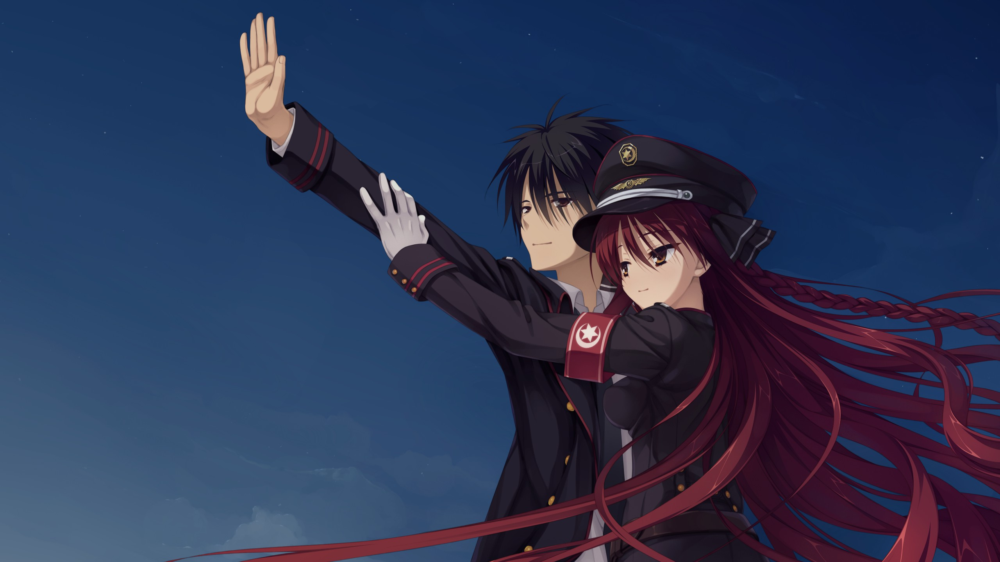
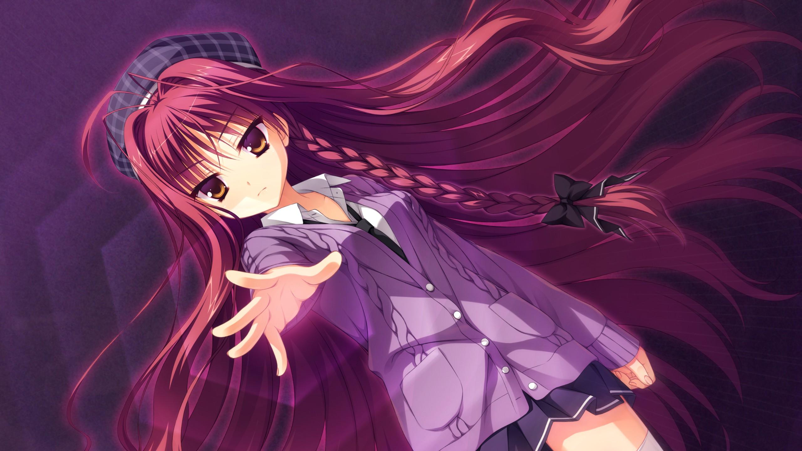

## 基本信息

| 项目 | 内容 |
| --- | --- |
| **游戏名** | Dracu-Riot |
| **开发商** | Yuzusoft |
| **日文发行商** | Yuzusoft |
| **中英文发行商** | HIKARI FLELD |
| **原作发售日** | 2012-03-30 |
| **Steam重置发售日** | 2026-02-27 |
| **个人游玩时长** | 约 17小时 |
| **个人评分** | ★★★★★ (10/10) |

## 原作介绍

> 漂浮在海上巨大人工岛屿海上都市，是个赌博和风俗（性交易）合法发展的特区。
本作主角六连佑斗因其好友仓端直太的邀请一同来了这欢乐特区，途中却遇到绑架事件，被卷入事件的佑斗意外发现这城市的秘密并成为了吸血鬼。
这座岛其实是政府唯一认可让吸血鬼和人类共同生活的城市，因此变成吸血鬼的佑斗只能够在这城市里生活下去。

登场人物(美羽线)

(1)六连佑斗
(2)矢来美羽
(3)布良梓
(4)稻丛莉音
(5)艾莉娜·奥列格芙娜·阿文(艾莉娜)
(6)尼古拉·凯菲尤斯
(7)大房妃依里
(8)荒神小夜
(9)安娜·莱缇库鲁
(10)淡路萌香
(11)扇元树
(12)枡形兵马
(13)仓端直太

## 角色简介

### 六连佑斗
本作男主角，体质特殊，喝了一口吸血鬼的血就变成了吸血鬼，并因此被迫留在了海上都市，搬进了月长学院第二宿舍。

孤儿，从小在孤儿院长大，靠打各种工维持生计，做过各种各样的兼职，不亚于NW的藤岛匠的打工皇帝。打过的工包括：饮食店、警备员、道路工程、交通管理、大楼清洁、搬家公司、快递、音乐会的staff等

曾经因为手术长期住院，所以实际上早就成年了，比同年级的人要年长。

在来到海上都市之前，就读于石英学院，成绩不错，运动神经也很好。持有自考的手动挡驾照，喜欢汽车，开车技术了得。学过柔道。

虽然变成吸血鬼之后喝酒千杯不倒，但依旧每次去酒吧都点可乐喝。

体质特殊，有着狼人体质，能使用多个超能力。战斗力非常强大。

### 矢来美羽（CV：夏野こおり）
月长学院学生，特区事务管理局（阴阳局）风纪班所属的吸血鬼少女，能力为念力，在负责维护治安的组织里工作。

责任感很强，属于会好好教导他人的类型。偶尔会说些难为情的话来捉弄人，只是由于她本人就很容易害羞，而且为人单纯，结果反倒成了满脸通红的言语攻击（？），这样的个性难免让人汗颜。

虽然周围的人都认为她是个S，但本人却主张自己是个M。

意外的害怕鱼，因此无法制作鱼料理

害羞的时候会红着脸一字一顿地说出“うーるーさーい”（吵死了）。

对于恋人的气味有一定的执着（需求），无法直接摄取的话极有可能会从恋人的贴身衣物摄取。

而事实上，虽然平时的确是S气场全开的样子，但很多时候都渴望着被强硬的方法对待，些许自虐的想法以及过度的自责，所以某种意义上来说的确是个M。

因为吸血鬼不会喝醉酒，所以本人很喜欢喝些高酒精度数的烈酒，而且不擅长料理。

很容易吃醋嫉妒，此时会对恋人报以冷眼或者冷嘲甚至报复，有时也会夹带自虐的话语。

但是因为其单纯正直的性格理解实际情况，所以很快就能恢复过来。

经常以合格/不合格为自己的恋人的语言以及举动评分，而且评分要求很高，但因为比较心软，所以基本都算及格的。

曾说过自己是极具精神强迫症的女人，如果恋人死去会殉情，绝不会苟且偷生。

美羽的父母因为不适应海上都市的理念而离开了，但美羽则爱着海上都市目前的模样而留在岛上。

认为自己是个大人所以说些羞耻的话也没什么大不了的，但实际上本人很容易害羞，基本上是边红着脸边讲羞耻的事。

由于认为是因为自己的缘故才会让佑斗变成吸血鬼，因此决定负起责任，和佑斗一起生活教导他吸血鬼的生存方式。

#### 萌点
傲娇、毒舌、呆毛、制服、警察、大檐帽、吸血鬼、玩头发、S属性、M属性、醋缸、酒豪、onani

## 攻略路线

和美羽线（仅供参考）

- [ ] ◆和美羽一起
- [ ] ◆该选项随意（:spoiler[选「巨乳」可触发最后一项]）
- [ ] ◆果然还是算了吧
- [ ] ◆没办法，打吧
- [ ] ◆帮她涂吧
- [ ] ◆提议帮她涂
- [ ] ◆这还是太给她们添麻烦了吧（:spoiler[非「巨乳」时自动选择，不出现]）

## 主观评价

## Staff
剧本：天宮 りつ、姫ノ木 あく、J・さいろー
角色设计：こぶいち（莉音、艾莉娜等）、むりりん（美羽、梓等）
原画：こぶいち、むりりん
SD原画：こもわた 遙華
CG：モドキさん、煎路
音乐、音效：Famishin、Angel Note
企划、原案、监督、OP动画：ろど

## 相关音乐
主题曲：Scarlet
作词：榊原由依
作曲：Famishin
编曲：井ノ原智（Angel Note）
歌:榊原由依
片尾曲：君だけの僕
作词：Riryka（Angel Note）
作曲：Famishin
编曲：井ノ原智（Angel Note）
歌:Riryka（Angel Note）

## OP/ED

<iframe width="100%" height="468"
  src="//player.bilibili.com/player.html?bvid=BV1UoHzzAEW8&p=1&autoplay=0"
  scrolling="no" border="0" frameborder="no"
  framespacing="0" allowfullscreen="true">
</iframe>

<iframe width="100%" height="468"
  src="//player.bilibili.com/player.html?bvid=BV1REPmzJE5y&p=1&autoplay=0"
  scrolling="no" border="0" frameborder="no"
  framespacing="0" allowfullscreen="true">
</iframe>

本文部分内容来自[萌娘百科](https://mzh.moegirl.org.cn)阅读更多：https://mzh.moegirl.org.cn/DRACU-RIOT!
本文引自萌娘百科(https://mzh.moegirl.org.cn )，文字内容默认使用《知识共享 署名-非商业性使用-相同方式共享 4.0》协议。